# TFA8: Locking It Down (Resource Controllers and Authentication in Laravel)

IT0049 Web System Technologies. A Laravel 12 point-of-sale (POS) application, continued from TFA7, where customer and user account management uses resource controllers and is only reachable by logged-in users.

## What changed in TFA8

- Customer and user routes are each a single `Route::resource()` registration.
- Both controllers use the seven conventional methods: `index`, `create`, `store`, `show`, `edit`, `update`, `destroy`.
- Laravel Breeze (Blade) provides login, registration, password reset and profile pages, adapted to the `username` and `full_name` fields.
- The `auth` middleware protects every customer and user account route.
- The migrations now include the `email` and `password` columns needed for login.
- Passwords are stored hashed, and you cannot delete the account you are logged in with from the user list.

## Requirements

- PHP 8.2 or newer with the `gd`, `fileinfo`, `pdo_sqlite` and `zip` extensions
- Composer
- Node.js 20.19+ or 22.12+ and npm

## Setup

```bash
git clone https://github.com/LordofCinder1/WEBSYS-TFA-8.git
cd WEBSYS-TFA-8

composer install
cp .env.example .env        # Windows Command Prompt: copy .env.example .env
php artisan key:generate

php artisan migrate --seed  # answer "yes" if asked to create the SQLite database
php artisan storage:link    # makes uploaded avatars visible

npm install
npm run build

php artisan serve
```

Open <http://localhost:8000>.

### Demo login

| Email | Password |
| --- | --- |
| `alice@example.com` | `password` |

All five seeded users share this password. It is for local testing only.

### Using MySQL instead of SQLite

Create an empty database, set these values in `.env`, then run `php artisan migrate --seed`:

```ini
DB_CONNECTION=mysql
DB_HOST=127.0.0.1
DB_PORT=3306
DB_DATABASE=tfa8
DB_USERNAME=root
DB_PASSWORD=
```

> If you reuse an older TFA7 database, run `php artisan migrate:fresh --seed`. This **erases** its existing data.

## Routes

From [`routes/web.php`](routes/web.php):

```php
Route::middleware('auth')->group(function () {
    Route::resource('customers', CustomerController::class);
    Route::resource('users', UserController::class);
    // profile routes
});
```

| Method | URI (`users` follows the same pattern) | Controller method |
| --- | --- | --- |
| GET | `/customers` | `index` |
| GET | `/customers/create` | `create` |
| POST | `/customers` | `store` |
| GET | `/customers/{customer}` | `show` |
| GET | `/customers/{customer}/edit` | `edit` |
| PUT/PATCH | `/customers/{customer}` | `update` |
| DELETE | `/customers/{customer}` | `destroy` |

## Access control check

Requesting a protected page while logged out redirects to the login page:

```text
$ curl -i http://localhost:8000/customers
HTTP/1.1 302 Found
Location: http://localhost:8000/login
```

Automated tests cover the redirect on all 14 account routes, logged-in create/view/edit/delete, password hashing and the Breeze authentication flows:

```bash
php artisan test
# Tests: 29 passed (123 assertions)
```

## Screenshots

### Logged out

**Home page**

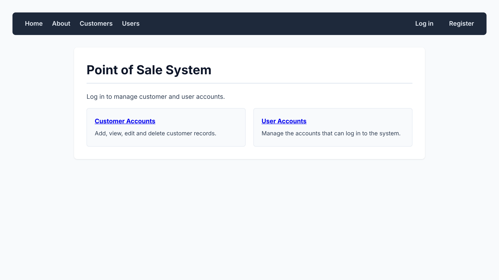

**Visiting `/customers` while logged out redirects to login**

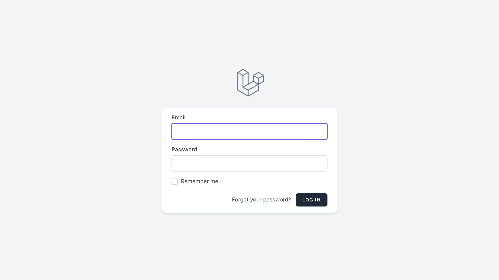

**Registration**

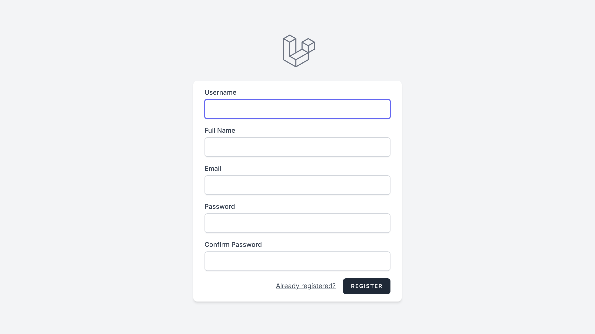

### Logged in

**Dashboard**

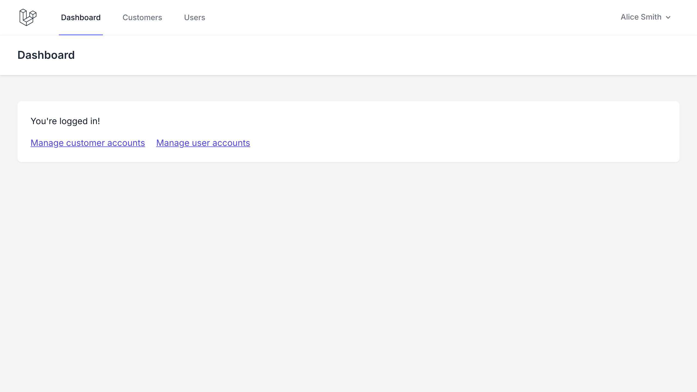

### Customer accounts

**List**

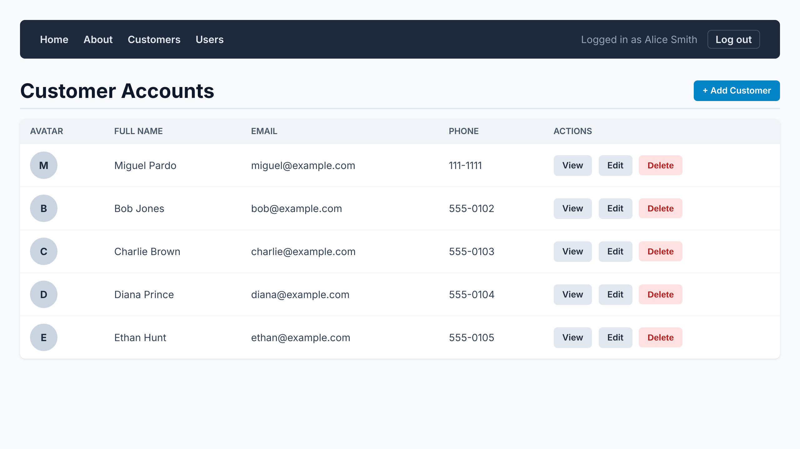

**Add**

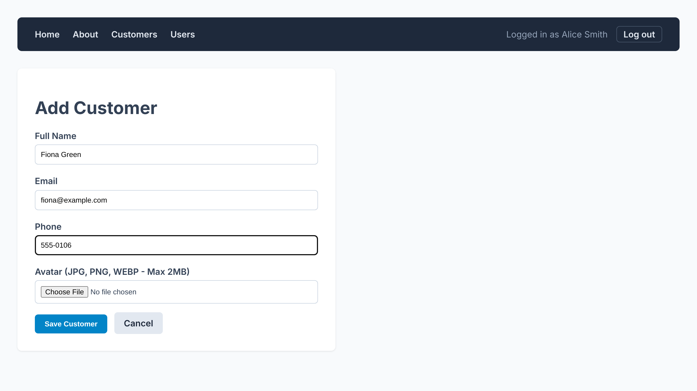


**View**

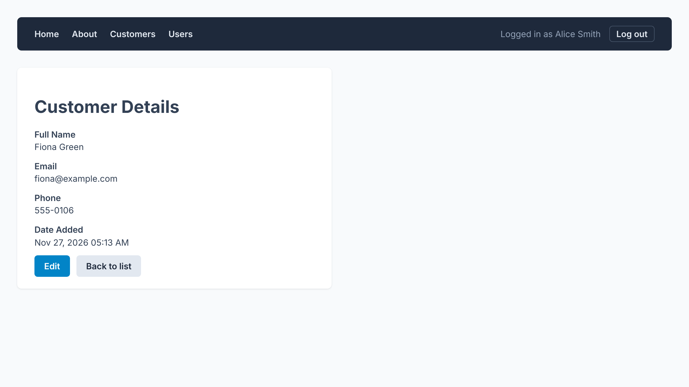

**Edit**

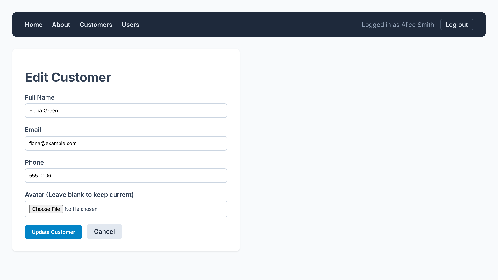

**Delete**

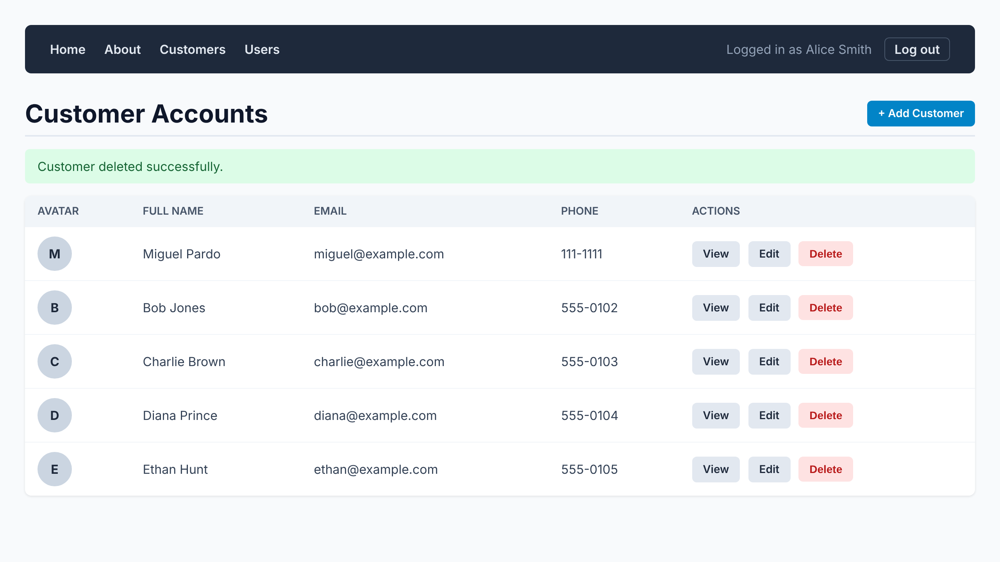

### User accounts

**List**

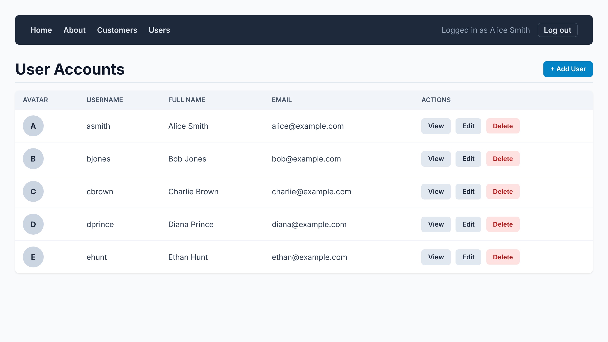

**Add**

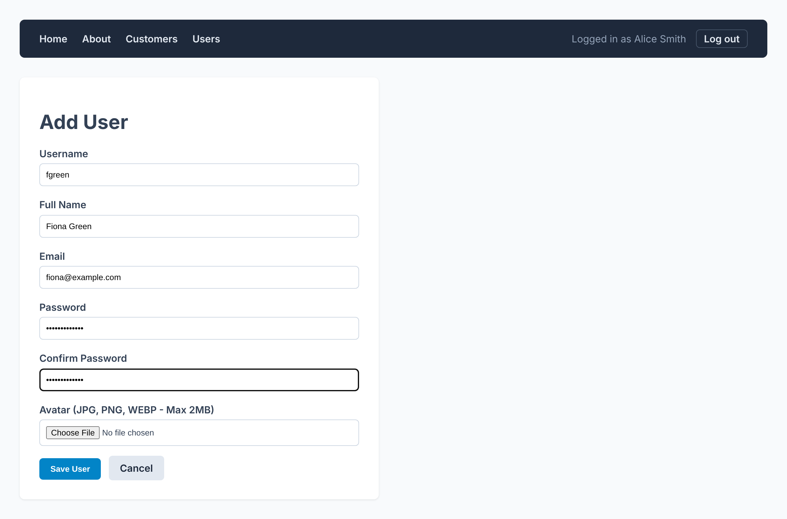

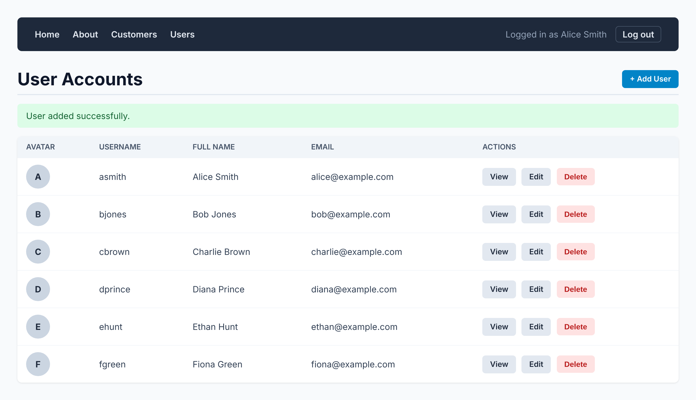

### About page

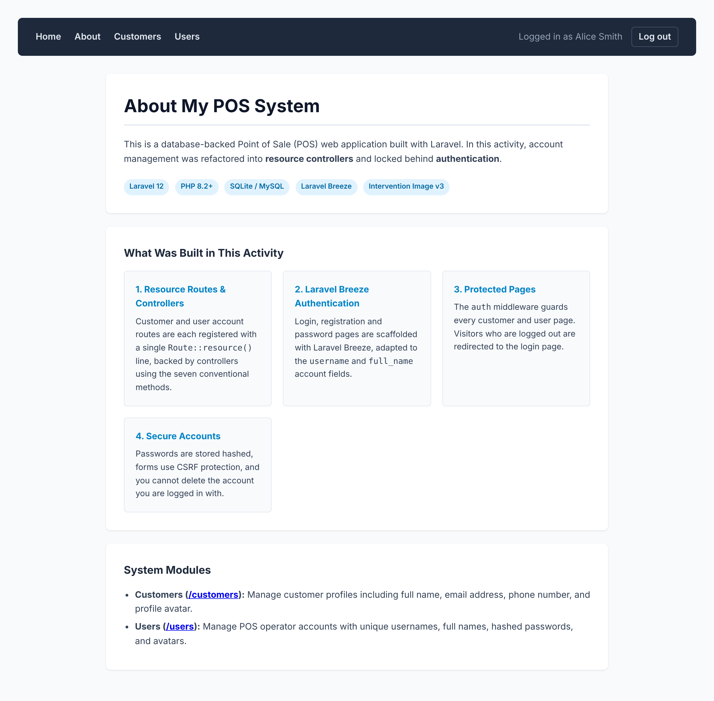
